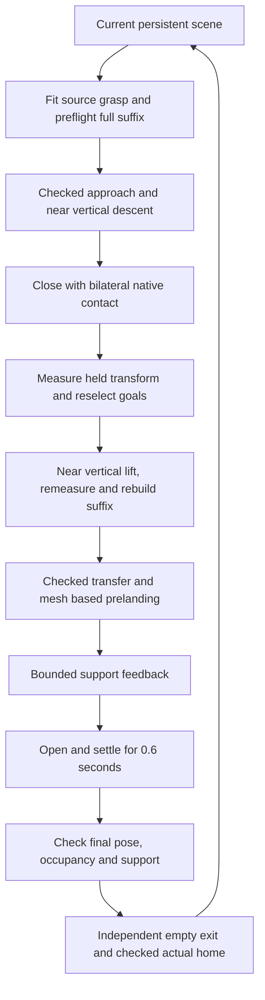

# Simulation control handoff — SO-ARM101

**Snapshot: 10 November 2026. Audience: the developer taking over simulation control.**

The immediate goal is to reproduce and improve the PyBullet workflow on a new computer. Hardware control is a later project stage. Start with [the installation guide](simulation/README.md), then read this document before changing control parameters.

## 1. What you are taking over

The current system moves chess pieces using known simulator state, numerical inverse kinematics (IK), collision queries and feedback from native PyBullet contacts. It has five arm joints and one gripper joint. Each game keeps one physical scene alive across moves; query worlds are separate and may be reset for planning.

The latest controller uses native contact holding with natural piece rotation. It does **not** weld the piece to the gripper or project its orientation. The older October video used an ideal fixed grasp and different geometry; its results belong to that older configuration. Vision recognition is a separate module. The current control input is a frozen list of moves and simulator poses, not camera detections, a learned VLA policy or a chess engine.

The handoff includes the runtime dependency closure, current robot and piece assets, grasp catalogs, IK seeds, three original ten-action sessions, the unchanged experiment gate, a portable workspace materializer, an environment checker and selected historical evidence. Python controller/planner files are copied without changes. JSON paths and URDF mesh paths are rebased; [the manifest](simulation/manifest.json) records source and exported SHA-256 hashes and every transformation.

## 2. Verified baseline and remaining work

The latest physical simulation assessment combines two registered executions: the first stopped after game 1's first action; the second ran only the previously unattempted games 2 and 3. There was no retry of game 1.

| Original session | Complete actions | Physical starts | Stop / result |
| --- | ---: | ---: | --- |
| `random1_seed101` | 0 / 10 | 1 | Queen f7→d7 placed and settled; empty-gripper exit planning rejected before withdrawal/home |
| `random2_seed202` | 10 / 10 | 10 | Complete, including checked physical home after every action |
| `random3_seed303` | 5 / 10 | 6 | Black knight d6→f5 settled at XY error 3.043153 mm, above the 3 mm limit; no withdrawal/home for that action |
| **Total** | **15 / 30** | **17** | **1 / 3 complete games; 13 later actions unattempted** |

The runs used 139,663 physics ticks, or 581.929167 simulated seconds at 240 Hz. The 15 complete actions had correct final cell occupancy, support before opening, 144 actual settled-support ticks after release, and checked withdrawal/home. Their largest final XY error was 1.576996 mm. Reviewed records and guards showed no drop or unintended collision in these 17 prefixes/actions. This is evidence for these scenes, not a general reliability estimate.

Across 38,529 sampled unsupported, unreleased holding states, neither jaw's native normal force was at or below 0.001 N; the minimum bilateral reading was approximately 0.240663 N. This does not establish constant regulated pressure or continuous-time/hardware stability. Pickup and placement TCP horizontal excursions were diagnostic measurements, with maxima 0.390537 and 0.340427 mm respectively.

The three requested workflow corrections are present:

1. **Rebuild from measured grasp geometry.** Reselect bounded destination yaw/height goals after closing and again after the actual lift; retain the existing Cartesian route first, with a fully sampled direct joint bridge as fallback.
2. **Confirm physical board support before opening.** Descend to a native mesh prelanding gap, use bounded support probes, then perform actual released settling.
3. **Plan empty withdrawal independently.** Use the actual opened state and an independently selected exit height, followed by collision-checked actual home.

One complete action, white knight c7→d5 in game 3, exercised the joint-bridge fallback successfully. Its selected route contained 90 checked nodes; its predicted minimum carried mesh/board gap was 19.701812 mm. This is one successful use, not broad fallback coverage. The first and third games still expose limits discussed below.

The current `run_three_staged_v2.py` fixes classification of an expected empty-return planning rejection. The complete three-game batch has **not** been physically rerun through that v2 entrypoint. Do not describe the packaging/static checks as another three-game run.

Evidence: [combined raw audit](artifacts/control-20261110/combined-raw-audit.json), [knight opening/settling measurements](artifacts/control-20261110/knight-final-xy.json), and [evidence index](artifacts/control-20261110/README.md). Review was a separate raw-data pass by the same GPT; `independent=false`.

## 3. Environment and installation

| Component | Recorded physical-run baseline |
| --- | --- |
| Host | Windows; native CPU PyBullet process |
| Environment | `.venv-chess-benchmark`, created with uv; never copy the environment directory between computers |
| Python | 3.10.20, 64-bit |
| NumPy / SciPy | 1.26.4 / 1.14.1 |
| PyBullet | 3.2.7; local Windows build reports 7 October 2026 |
| python-chess / chess | 1.999 / 1.11.2 |
| Physics timestep | 1/240 s |
| Control dependencies | CPU only; no GPU, CUDA, ROS, DeepSeek key, detector weights or Stockfish required |

The portable package has separate verification records for Windows and Ubuntu/WSL. See [portability validation](artifacts/control-20261110/PORTABILITY.md) for the actual versions and the limits of those checks. A Linux import/static-load pass does not reproduce the Windows dynamic-contact results. PyBullet builds and platforms can produce different contacts and timings even with the same package version.

The [quick start](simulation/README.md) creates a new virtual environment and materializes all machine-specific paths into a new workspace. Do not launch the tokenized templates directly from `simulation/runtime/`. Do not use the repository's vision requirements for this control-only setup.

## 4. Current geometry, frames and materials

All controller positions are in **metres**, joints in **radians**, and time in **seconds** unless a field explicitly says otherwise. Larger gripper angle opens; smaller angle closes. `q5` is ordered shoulder pan, shoulder lift, elbow flex, wrist flex, wrist roll. The TCP is `gripper_frame_link`.

The current piece meshes come from the project's November scanned-piece scene, exported from `initial_mount.blend` (source hash retained in the asset profiles). They replace the older Dubrovnik geometry. The six visual OBJ meshes and 18 convex collision slabs per piece are included, with NPZ geometry for further grasp/geometry work. The slabs preserve the neck profile but can conservatively fill local concavities.

| Piece | Mesh height | Simulated mass |
| --- | ---: | ---: |
| Pawn | 23.000 mm | 3 g |
| Rook | 25.500 mm | 3 g |
| Knight | 27.495 mm | 3 g |
| Bishop | 32.000 mm | 3 g |
| Queen | 35.000 mm | 3 g |
| King | 45.000 mm | 3 g |

Masses are assumptions. Inertia uses a bounding-box approximation around a volume-weighted compound centroid; magnet distribution has not been measured. Friction is a simulation setting, not a material measurement. Each paired contact body uses lateral friction `sqrt(0.4)` in the current setup. Do not infer a physical material or calibrated robot from these values. Source/provenance details are in [THIRD_PARTY.md](THIRD_PARTY.md).

The robot base frame has +Z upward. Board centre is `(0.24, 0)` m, board yaw is +90°, and square size is **0.025223229104719604 m**. If `f=file_index−3.5`, `r=rank_index−3.5`, rotate `(f*s, r*s)` by board yaw, then add board centre. Thus file/rank directions are not simply world X/Y. Use `QueryWorld.square_xyz()` rather than duplicating the mapping.

Board top is `z=0.01266` m; board bottom and tabletop are `z=−0.0024` m. Board half-extents in its own XY axes are `(0.124, 0.1229)` m. The display offset from base coordinates is +0.0024 m. Keep physical and display frames separate.

The native collision-floor offset is 1 mm and initial piece clearance is 1.2 mm. These account for the observed compound-child collision envelope; they are model assumptions. A 50 µm top-level collision margin does not remove that child envelope. Do not replace native mesh contact gaps with visual bottom-height differences.

`getBasePositionAndOrientation()` returns the body's inertial/COM frame. The project's `bottom_pose()` subtracts the rotated COM offset to obtain the mesh reference/bottom pose. Mixing them shifts placement and grasp transforms. The measured held transform is `H = inverse(T_TCP) @ T_piece` using the same frame convention throughout.

## 5. One move, end to end

Before grasping, the planner checks a nominal complete path, including release/return. Grasp candidates are refitted to the **current** piece poses; archived world coordinates are not replayed as a fresh grasp. Bishop candidates `bishop_1_0` and `bishop_3_0` receive priority, while the original candidates remain available.

After bilateral closure, measured geometry replaces the nominal held relationship. Bounded yaw/height reselection and suffix reconstruction run after closing and lifting. IK alone does not approve a route: interpolated edges must pass joint, self-collision, board and neighbouring-piece checks. The original Cartesian transfer is tried before a direct joint bridge. The current baseline is not a new OMPL search benchmark; historical OMPL helpers remain in the import chain.

At the destination, the carried native mesh approaches a nominal 2 mm board gap (accepted prelanding band 1–3 mm). Feedback permits at most six 0.5 mm downward probes and requires board normal force above 0.005 N for 0.06 s before intentional opening. After opening, 0.6 s of actual simulation checks support and the final pose. Final occupancy alone cannot establish that a piece was never dropped before opening.

The opened gripper then gets a new empty-exit plan. Exit height is independent of carry height: 20, 30, 40 and 15 mm candidates are tried. The endpoint must clear the old target by at least 0.5 mm. The arm physically follows a checked path home; final joint error must be within 2°. A piece placed at its destination without checked exit/home is an incomplete action.

Actual worlds are protected against resets/teleports during execution. Query worlds intentionally reset robot/piece geometry for checking. Do not remove the actual-world protection to make a planner or fixture pass.

## 6. Source map and reading order

Paths below are relative to the **materialized workspace**. The long dated directories preserve audited source identity; renaming them can break root resolution and imports.

Let `C = calibration/manipulation_20261109_v1/`.

| Role | File |
| --- | --- |
| Three-game entry and whole-operation contact wrapper | `C/staged_continuous_3x10_20261110_v1/work/run_three_staged_v2.py` |
| Batch outcomes and stop classification | Same directory, `staged_three_batch_v2.py` |
| Session binding, resident planning and bounded source search | `C/staged_manipulation_20261110_v1/work/prepared_session_staged_v2.py` |
| Persistent physical scene and inter-action coordination | Same directory, `sequence_coordinator_staged_v1.py` |
| Per-action physical phases and final task checks | Same directory, `staged_runner_v2.py` |
| Planning world reuse / IK fitting | Same directory, `resident_planner_staged_v2.py` |
| Measured-grasp suffix and direct bridge fallback | Same directory, `stage_routes_bound_v3.py`, `transfer_bridge_v2.py` |
| Empty exit and home planning | Same directory, `release_planner_bound_v1.py` |
| Actual support probes | `C/knight_support_20261110_v1/work/support_feedback_v2.py` |
| Current-scene grasp candidate selector | `C/adaptive_continuous_20261110_v1/work/adaptive_selector_bound_v1.py` |
| Current IK solver | `C/far_grasp_fast_20261110_v1/work/tilt_ik_v1.py` |
| Phase-aware geometry checks | `C/staged_manipulation_20261110_v1/work/query_safety_bound_v1.py` and `C/keypoint_grasps_20261110_v1/work/pilot_geometry_contact1mm_v1.py` |
| Native-contact holding implementation | `experiment_review/tools/recontact_hold_control_v1.py` and its imported control modules |
| Current actual/query scene implementation | `C/smoke_grasps_20261110_v1/work/query_world_snapshot_v1.py` |
| Global contact threshold forwarding | `C/first_contact_root_20261110_v1/work/threshold_factory_v2.py` |
| Low-level Bullet world / kinematic chain | `reachability_eval/physics_world.py`, `reachability_eval/core.py` |

Read the entry → session → coordinator → runner first. Follow imports before editing an older helper: the active runtime binds versioned modules, and a similarly named historical file may not be called. Some modules dynamically compile a pinned predecessor; those predecessor files must remain present.

The three session JSONs specify twelve initial pieces, the ten frozen moves, IK seeds, catalog candidates and limits. `base_query` supplies current assets, board geometry and initial placement assumptions. `initial_home_plan` supplies the checked home seed. The `results_v2/.../ik/result.json` files in the package are historical **seeds**, not proof that a new source/destination is reachable or that a new grasp succeeded.

## 7. Parameter limits and where to reconsider them

Keep a versioned baseline. Some tolerances can be too strict for the task, particularly during intended release contact. Reassessing them is part of the handoff; the existing failures must retain their original scores.

| Parameter / current value | Purpose / owner | Interpretation |
| --- | --- | --- |
| Global `contactBreakingThreshold = 0.002` m | `threshold_factory_v2.py` wrapping **all** constructors for the full operation | Active validated contact profile. Legacy `physics_world.py` still contains 0.0002 for historical hashes; direct use silently restores the old condition. Always keep the wrapper. |
| `dt = 1/240` s | Current query config and actual `QueryWorld` | Physical baseline. Do not change timestep together with force/friction when investigating one issue. |
| Target force 0.25 N per jaw; torque cap 0.05 N·m | Runner / imported grip control | Setpoint and effort cap, not guaranteed measured pressure. Raising the cap is not an established fix. |
| Final XY ≤3 mm; piece tilt ≤10° | `staged_runner_v2.py` | Task acceptance. The knight stopped only 0.043153 mm beyond XY. Review the required centring accuracy and uncertainty before selecting a new tolerance. |
| Hard geometric penetration tolerance 0.05 mm | Geometry checker | Very small compared with contact envelopes. The queen's empty exit predicted about 0.06 mm finger/target overlap at its starting state. A phase-aware, monotonically separating departure may be more appropriate than globally weakening collisions. |
| Neighbour reserve 0.5 mm | Geometry checker | Clearance policy, separate from allowed target/finger/support contact. Retain neighbour checks when revising release handling. |
| Planned target/board lower-phase allowance 1 mm | Current contact-aware geometry policy | Specific intended-support phase, not permission for airborne board collisions or other contacts. |
| Carried transfer mesh/board clearance ≥10 mm | Transfer bridge / stage planner | Current transfer policy; measured from collision mesh, not TCP height. |
| IK fit: position ≤5 mm, rotation ≤10°, tool tilt ≤30°, joint margin ≥5° | `tilt_ik_v1.py` | Solver admission, distinct from final 3 mm physical placement. Joint bounds include about 5.01° margin. These choices can reject feasible task poses; assess actual failure records before changing them. |
| Cartesian samples ≤1 mm / 1°; checked joint-edge increments ≤0.25° | Route/geometry code | Collision discretization. A 2° adjacent-IK diagnostic is distinct from final task accuracy. |
| Source search: ≤28 profiles, ≤4 valid centres, ≤64 complete nominal-plan checks; aggregate 60 s, centring 15 s | Selector/session | Search/resource limits. Exhaustion is not proof of global unreachability. Slower computers can hit them earlier. |
| Measured-grasp reselection ≤12 goals, shared 45 s per rebuild | Stage planner | Bounded post-grasp planning. Preserve an explicit total budget if expanding it. |
| Per action ≤24,000 steps and 180 s wall; per game 900 s; batch 2,700 s | Session/batch configs | Resource limits, not physical task failures. Simulation time and process wall time differ. |
| Support >0.005 N for 0.06 s; settle 0.6 s | Support feedback / runner | Actual support and release criteria. Preserve phase and timing evidence. |

**First unresolved case — queen f7→d7:** all four exit heights failed near the same initial opened pose. The piece had been intentionally opened and supported for 144 ticks. The checker predicted approximately 0.06 mm overlap against a 0.05 mm limit. This was a post-release planning block; no exit motion or observed neighbour collision occurred. Simply increasing the exit height does not resolve the shared rejected origin. Inspect intended jaw/target contact, native/query geometry agreement and a controlled separating departure.

**Second unresolved case — knight d6→f5:** XY was 2.894227 mm before opening, 3.043842 mm after opening and 3.043153 mm after settling. The piece was board-supported with approximately 0.01446° tilt. The data show movement during opening; they do not isolate a unique cause. Consider placement centring and release mechanics as well as whether 3 mm is unnecessarily strict for the intended task. A new criterion must be declared before a new run, rather than retrospectively turning this result into a success.

Tiny slip, relative rotation, force bands, recovery counts and small gripper-angle changes are diagnostics in the current task policy; do not reinstate them as independent aborts. Continue checking actual unintended collision, unsupported separation/drop, occupancy, intentional release, board support and checked home. Whole-trial median force and final destination occupancy can conceal an earlier airborne drop.

## 8. Running, evidence and changes

Use the [quick start](simulation/README.md) for exact commands. The first environment check forbids `stepSimulation` even during imports/constructors, verifies the actual twelve-body scene and writes a static PNG. Its result is an environment pass only.

New manipulation runs use `experiment_review/experiment_gate.py check --phase start`, then `run --record`. A ready baseline reproduction template is supplied; pin the **materialized** configuration bytes before launch. Pinning hashes is not scientific approval. If you change geometry, thresholds, controller, layout, moves or budgets, create a new reviewed record and explain the change. Do not overwrite old output directories or retry automatically.

A failed task stops its game; the other games may continue. A program/evidence fault stops the batch. Keep program faults, preparation/planning blocks, physical failures and completed actions separate. For example, v1's queen exit was initially labelled `program_error`; the raw placement evidence and derived planning interpretation are both retained.

Outputs include batch/session `result.json`, `planner_stats.json`, per-ply/trial results and compressed `trace.jsonl.gz`, plus `threshold_forwarding.json`. Keep game, ply, phase, tick, physical client/body identity, commanded motion, measured joint state, piece pose, native jaw/board/other contacts, support/open status and the selected planning method. Inspect complete action endings, including home. Do not count a zero exit code, a successful IK solution or an old replay as a new physical success.

Preserve the original robot/planner files when making a correction, use a new version, and test the actual namespace/callback/constructor bindings. An interface mock alone does not prove native contact behaviour. The local project workflow used GPT for planning/review and DeepSeek for implementation; **running this package does not need an API key**. Repository provenance records implementation calls separately from program checks and physics results.

## 9. Boundaries of this handoff

This is a headless PyBullet control snapshot. It does not establish hardware motor calibration, serial communication, joint-zero conventions on a real arm, emergency-stop behaviour, camera extrinsics or real-object friction. There is no hardware launch step in the setup guide. Reuse the concepts later only after measuring the real system.

The older [October simulation report](SIMULATION-20261012.md), video and Dubrovnik detector remain available as historical results. Their assets, board dimensions and ideal fixed attachment differ from the November baseline. The public evidence subset contains audits and selected records; full high-frequency recordings and the original Blender authoring scene remain with the maintainer. Asset profiles retain the authoring scene hash so a future geometry revision can be traced.
