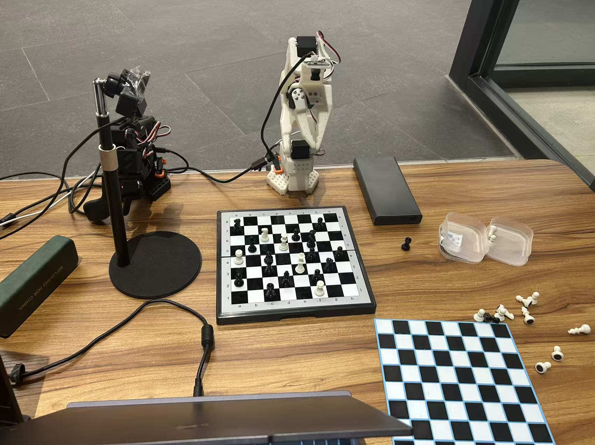
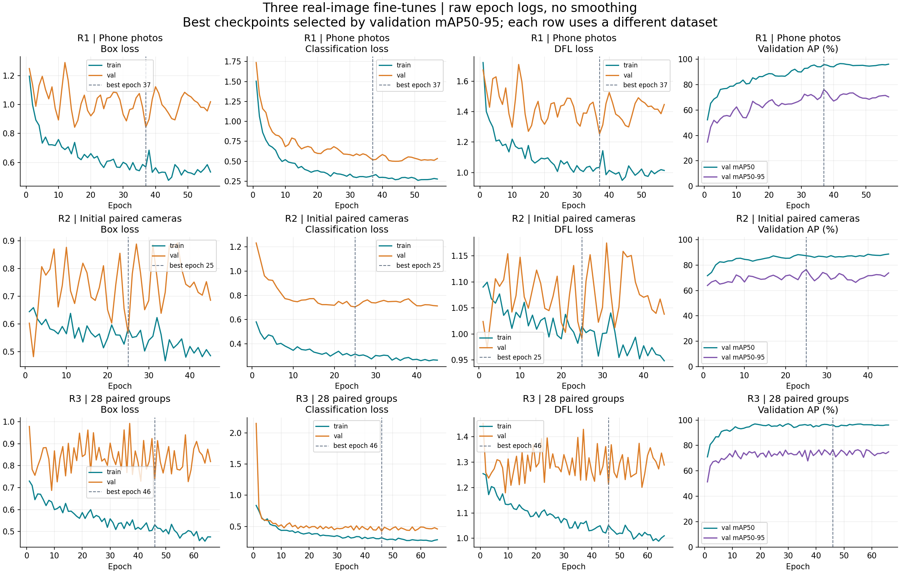
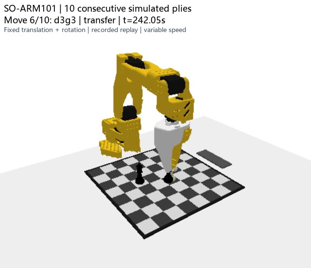
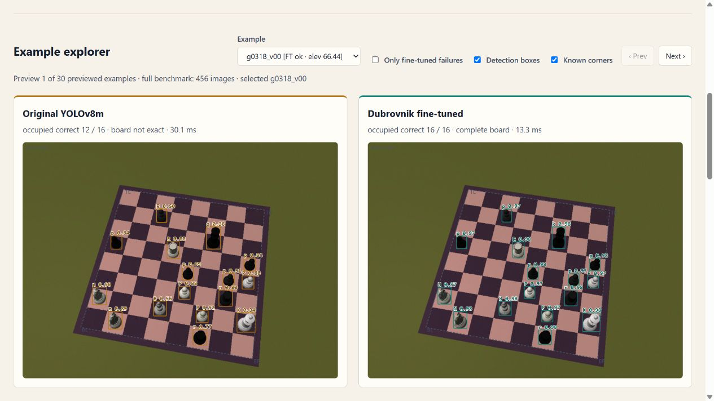

# SO-ARM101 Chess Player — Vision & Simulation

## New: real-camera chess recognition — 2026-10-23

**[实拍识别完整报告：实验环境、三次微调、loss 曲线与前后对比](REAL_VISION.md)**

当前固定棋具下，已经跑通双摄实时 **“棋子类别＋检测框＋棋格坐标”** 预览链路：相机 2 为主、相机 1 辅助，使用棋盘附近输入与参考辅助网格关联。最新 28 组实拍微调在留出的两组主视角照片上，由 **46/56（82.1%）提高到 53/56（94.6%）** 类别与框正确匹配。

The real-camera pipeline now displays **piece class, bounding box, and square coordinate**. The latest fine-tune uses 28 paired groups, split into **23 training / 3 validation / 2 test groups**, on an RTX 5070 Laptop GPU. Main-camera class-and-box matches improved **82.1% → 94.6%** on those two held-out groups; combined-camera detection mAP50 improved **68.0% → 89.5%**.

**Scope:** the live class/grid pipeline was accepted with an earlier checkpoint. The newest weights have been evaluated offline on reviewed board crops and are **not yet deployed**. The 94.6% result is not square-coordinate, fusion, or full-board accuracy; **0/2 main-camera boards were entirely correct**. See the report for remaining black-rook confusions, occlusion, and sample-size limits.

The report includes the actual live grid overlay, three real-image training stages, raw epoch CSVs, paired before/after test metrics, successful corrections and residual failures. Each stage uses a different held-out set, so its metrics must be compared **within that stage**. This branch publishes the evidence and documentation; the newest checkpoint binary is not bundled.

## Earlier results: synthetic vision and virtual manipulation

The earlier vision module fine-tunes YOLOv8m for **ezeeone_Dubrovnik_1960_set_02_stls**. The PyBullet prototype tests SO-ARM101 picking up, moving, releasing pieces, and returning home across consecutive chess moves.

Those results retain their original scope: synthetic vision uses known board corners; motion uses known simulator state, IK/OMPL planning, and an **ideal fixed grasp** during transport. The new real-camera results above do not establish end-to-end vision-driven/VLA manipulation or real-robot grasping success.

## New: 10 consecutive simulated moves

**[Watch the 90-second simulation demo](https://wangyh666-ust.github.io/Chess-Player------SOARM-101/#simulation)** · [Download MP4](docs/assets/simulation-random2-10plies.mp4) · [Simulation experiment](SIMULATION.md)

The clip shows one complete **10-ply (10 halfmove)** run, including each pickup, placement, and checked return home. It replays recorded poses at variable speed; exporting it did not rerun physics.

| Continuous simulation run | Completed / planned |
| --- | ---: |
| random1 | 6 / 10 |
| random2 — featured video | **10 / 10** |
| random3 | **10 / 10** |

Across the batch, **26/30 planned plies completed, with 2/3 complete games**. All 26 actions that entered physical manipulation completed release, settled board support, and checked home, with no observed drops or unintended collisions. One action was blocked before motion by candidate/placement-IK checks (`d4 → a1`); three later plies were unattempted. Maximum final XY error was **0.808 mm**.

**Ideal-grasp assumption:** after real bilateral closure, a fixed constraint holds both relative translation and rotation until intentional release. Native contact-force readings are retained and can still be zero. These results validate motion workflow under that assumption, not natural friction, constant-pressure control, or real-robot reliability.

## Interactive vision demo

**[Open the online demo](https://wangyh666-ust.github.io/Chess-Player------SOARM-101/)**.

Open [the demo](docs/index.html) **after cloning or downloading the repository**, or run a local server from the repository root:

~~~bash
python -m http.server 8000 --bind 127.0.0.1 --directory docs
~~~

Then visit **http://127.0.0.1:8000/**. The demo needs no Python packages, GPU, backend inference service, API key, or Internet connection when opened locally.

The English interface shows recorded original/fine-tuned detections side by side, ground-truth and reconstructed boards, camera elevations, and square-level errors. It includes **all 14 failed fine-tuned test frames**, the first six test frames, twelve evenly spaced frames, and the nine earlier scenes. Benchmark metrics always cover the complete evaluation set, independent of the preview filter. Detection overlays and board reconstructions come from saved predictions.

To host this static demo on GitHub Pages, select **Settings → Pages → Deploy from a branch → main → /docs → Save**. GitHub's source view does not execute HTML.

## Measured result

This section describes the **earlier synthetic benchmark**, not the new physical chess set. Held-out test: **456 synthetic images from 57 positions**, with **10,784 occupied ground-truth squares**.

| Metric | Original YOLOv8m | Dubrovnik fine-tuned |
| --- | ---: | ---: |
| Occupancy F1 | 89.97% | 99.99% |
| Piece color accuracy | 75.09% | 99.93% |
| Piece type accuracy | 66.00% | 99.89% |
| Piece color + type accuracy | 60.32% | **99.85%** |
| Completely correct boards | 0 / 456 | **442 / 456 (96.93%)** |
| Median processing time | 13.76 ms | 13.81 ms |
| 95th-percentile processing time | 27.87 ms | 21.89 ms |

Color/type/joint accuracy use **ground-truth occupied squares** as the denominator; missed pieces count as incorrect. Exact-board accuracy checks all 64 squares, including empty squares.

Timing was measured on an **NVIDIA RTX 5070 Laptop GPU (8 GB)** with batch size 1 and FP32 inference. It includes preprocessing, inference, and square mapping, and excludes disk reads, camera capture, and automatic corner detection. It is not a measured end-to-end robot frame rate.

The earlier nine scenes improved from **116/222 (52.25%)** to **222/222 (100%)** correct piece color + type, and from 0/9 to 9/9 completely correct boards. See [EXPERIMENT.md](EXPERIMENT.md) for the protocol, failures, and limitations.

## What is included

- [Real-camera report](REAL_VISION.md), current environment photograph, actual class/grid screenshots, [three-run training records and metrics](artifacts/real-vision-20261023/README.md), and latest held-out comparisons.
- [Simulation video](docs/assets/simulation-random2-10plies.mp4), [experiment summary](SIMULATION.md), and [recorded replay/evidence package](artifacts/simulation-v1/README.md).
- [Trained checkpoint](models/dubrovnik-yolov8m-v1.pt), approximately 49.6 MiB.
- [English interactive demo](docs/index.html), preview images, and recorded detections.
- [Full recorded evaluation](artifacts/dubrovnik-v1/comparison.json), [summary CSV](artifacts/dubrovnik-v1/summary.csv), [training log](artifacts/dubrovnik-v1/training-results.csv), and plots.
- [Split plan and source-mesh hashes](artifacts/dubrovnik-v1/split-plan.json) and [dataset statistics](artifacts/dubrovnik-v1/dataset-statistics.json).
- Synthetic data generation, fine-tuning, evaluation, and geometry helpers under [vision_eval](vision_eval).
- [Artifact verifier](tools/verify_artifacts.py) for checkpoint identity, stored prediction/mapping consistency, split isolation, and demo integrity.

The full 3,000-image dataset and original STL assets are generated/local inputs and are not bundled. Their absence does not prevent browsing the demo, verifying the saved results, or using the trained detector.

## Use the checkpoint

Install a CUDA-enabled PyTorch build suitable for your system and the [tested dependencies](requirements.txt). The original run used Python 3.10.20, PyTorch 2.7.1+cu128, torchvision 0.22.1+cu128, and Ultralytics 8.4.173.

For standalone piece detection:

~~~bash
yolo predict model=models/dubrovnik-yolov8m-v1.pt source=your_image.jpg imgsz=640 conf=0.25 iou=0.7 device=0
~~~

This uses the earlier **synthetic Dubrovnik checkpoint**, not the new real-camera weights. It produces bounding boxes and piece classes. Reconstructing square occupancy also requires ordered board corners and a known board orientation; the original portable mapper supports **known corners** only. The separate local real-camera prototype uses reference-assisted grid tracking, as documented in [REAL_VISION.md](REAL_VISION.md).

For verification of the published artifacts, a GPU and PyTorch are unnecessary:

~~~bash
python -m pip install numpy==1.26.4 opencv-python==4.11.0.86 Pillow==12.3.0
python tools/verify_artifacts.py
~~~

## Reproduce the experiment

See [REPRODUCING.md](REPRODUCING.md) for asset preparation and commands. It documents the external original checkpoint, source mesh files, tested environment, deterministic split, and full evaluation.

The intended later pipeline is:

~~~text
RGB image → board/piece recognition → verified board state → Stockfish
RGB + robot state + move instruction → VLA policy → SO-ARM101
New RGB image → recognition → execution verification
~~~

The repository now documents **real-camera adaptation, a live class/grid preview prototype, and preliminary continuous virtual manipulation**. The simulation uses known state and explicit motion planning; connecting visual recognition to robot execution, robust turn handling, VLA action learning, and hardware grasp validation remain subsequent work.

## Attribution and model workflow

The starting detector is from [alpkirisci/chess_detection_computer_vision](https://github.com/alpkirisci/chess_detection_computer_vision), trained on ChessReD2K. See [THIRD_PARTY.md](THIRD_PARTY.md) for sources and dependency information.

GPT handled experiment design, planning, analysis, decisions, and review. DeepSeek deepseek-flash handled code implementation through its official API. No credential or model-generation service is required to run this repository or demo.
