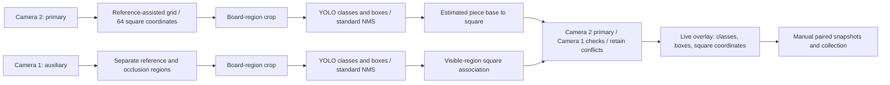
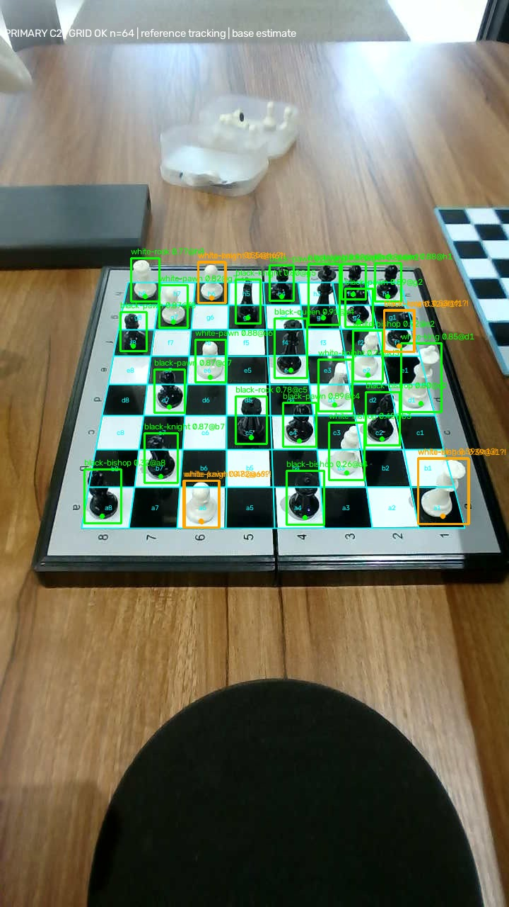
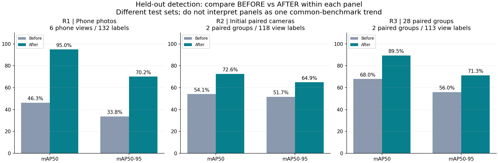
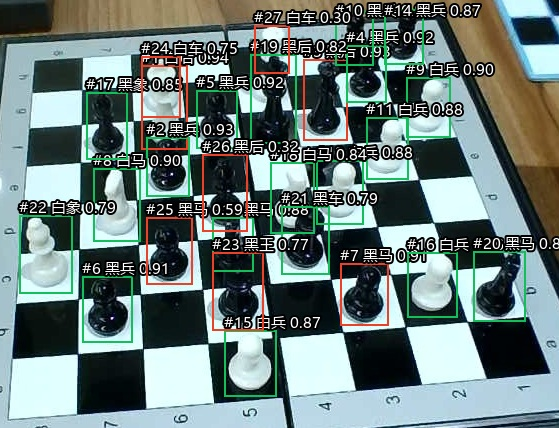
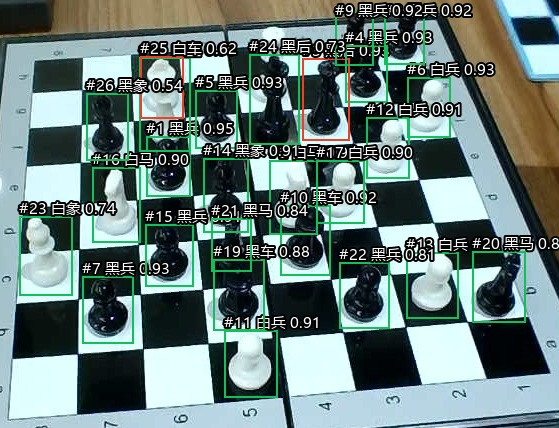
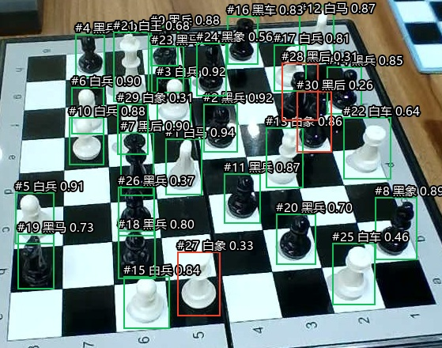
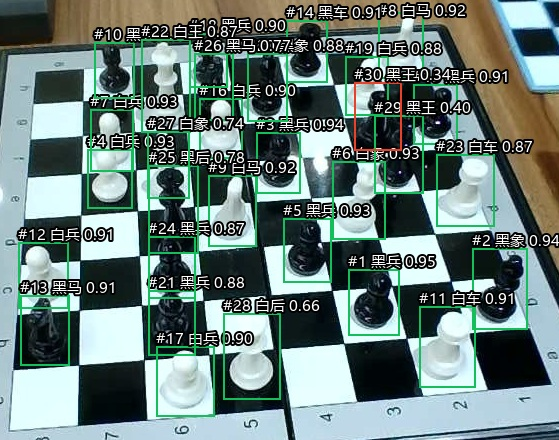
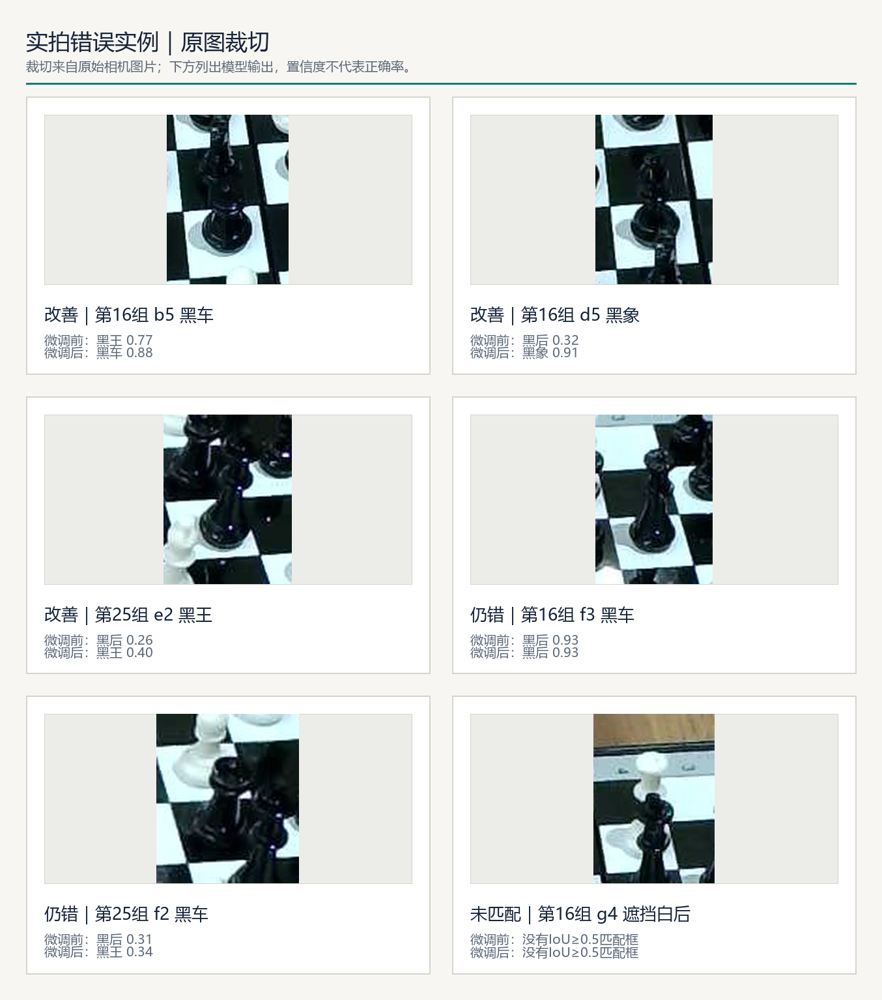

# Real chess-set adaptation: YOLO fine-tuning and dual-camera square recognition

**Language / 语言:** [<kbd> ← 简体中文 </kbd>](REAL_VISION.md) · [<kbd> English </kbd>](REAL_VISION.en.md)

Updated: 2026-10-23. This report concerns the physical pieces, black-and-white board with coordinate markings, and fixed dual-camera setup shown below.

**The live preview pipeline now displays piece classes, bounding boxes, and square coordinates. Fine-tuning on real photographs has produced a high preliminary detection match rate for this particular chess set.** On Camera 2 images from two held-out positions, the latest model improved correct class-and-box matches from **46/56 (82.1%) to 53/56 (94.6%)**.

These are two separate pieces of evidence: the live pipeline passed integration checks using an earlier model; the latest model trained on the 28-group dataset passed offline held-out evaluation and **has not replaced the live service's weights**. The 94.6% figure measures piece detection, not square-coordinate accuracy, dual-camera fusion accuracy, or complete-board accuracy. Both primary-camera test images still contain errors: **0/2 boards were entirely correct**.

## 1. Current experimental setup


The project user supplied this photograph; its pixels are unchanged. The table holds the SO-ARM101 leader and follower arms, a standard black-and-white board, and the current physical pieces. The blue-bordered board at the lower right was used in earlier tests. The current paired-camera training photographs use the standard black-and-white board.

| Component | Configuration and role |
| --- | --- |
| Camera 2 | Fixed primary side view for piece recognition and square association; the image is rotated to account for its mounting orientation |
| Camera 1 | Auxiliary camera on the follower arm, with a different viewpoint; the gripper occludes part of the board |
| Ubuntu host | Dual-camera acquisition, live preview, and the existing recognition pipeline |
| Windows training machine | NVIDIA RTX 5070 Laptop GPU, 8 GB VRAM |
| Training software | Python 3.10.20, PyTorch 2.7.1+cu128, Ultralytics 8.4.173, OpenCV 4.11.0 |
| Board orientation | A separate square-numbering orientation for each camera, using files a–h and ranks 1–8 |

This stage checks vision and data collection; no robot pick-and-place actions were executed. Saving the initial joint state is separate from visual recognition. Recognition outputs are not yet executable grasp coordinates.

## 2. How the live pipeline works



This is a combined vision pipeline: **YOLO predicts piece color, type, and bounding boxes; a geometry module determines grid lines and square names.** This round did not train YOLO to predict all 64 squares, nor did it train a new board detector.

1. Each camera has a reviewed reference image, board grid, and coordinate orientation. Reference-feature tracking, homography fitting, and black-and-white intersection checks update the grid in the current image. Small board shifts do not require recalibrating from scratch every time.
2. The detector receives a crop around the board, preserving the pieces' appearance rather than first warping the three-dimensional pieces into a top-down view. YOLO predicts 12 color-and-piece classes.
3. The existing live service uses YOLO's standard non-maximum suppression (NMS). Multiple detections assigned to one square are marked as conflicts. The offline comparisons below additionally apply a **large-box preference** rule, removing smaller boxes with substantial overlap and similar base positions. That rule is not integrated into the live service version shown here.
4. A heuristic estimates each piece's base from its bounding box and maps it to a square. Boundary cases, occlusions, and competing assignments remain unresolved or conflicting.
5. Camera 2 is primary. Camera 1 provides checks where usable and unoccluded. Each camera uses its own mapping; pixel coordinates are not directly combined. Conflicts are retained, auxiliary-only detections remain tentative, and an unknown square is not automatically considered empty.

The existing online crop extends the located grid by 15% on each horizontal side, 25% above, and 10% below; it falls back to the full frame when the grid is invalid. This differs from the tighter, ground-truth-assisted crops used in the offline evaluation below. Deploying the new weights therefore still requires aligning crop and postprocessing settings, then checking the actual input distribution and square associations. A larger box is not necessarily the correct box.

A reference image and coordinate orientation remain necessary. Large camera rotations, changes to the board's appearance, or movement beyond the reference tracker's range require an updated reference. This is not fully automatic board discovery from an arbitrary new scene.

### Recorded live output: classes and coordinates



This is **actual output recorded during live-service acceptance on 2026-10-23, using the R1 phone-photo model**, not the latest R3 model. Incorrect classes and unresolved associations are retained. The image demonstrates that the image → class → square coordinate → preview pipeline is connected.

See also [Camera 1's actual output](docs/assets/real-vision-20261023/live-camera1-grid.jpg). The preview supports independent overlay toggles, 0/90/180/270° rotation, pause, paired snapshots, and a local collection directory. Training uses both viewpoints; “Camera 2 is primary” is an online association rule, not a decision to exclude Camera 1 from training.

In one recorded acceptance status, both grids were valid. Grid processing took approximately 13.8/16.0 ms, the recorded processing durations were approximately 39.3/46.0 ms, and the camera timestamp difference was approximately 105 ms. These are **instantaneous samples**, not a sustained FPS benchmark or an end-to-end latency measurement for the latest model. See the [acceptance record with the host address removed](artifacts/real-vision-20261023/live-acceptance.json).

## 3. Data collection, annotation, and preparation

Different positions are arranged on the board, with one paired-camera capture saved for each group. GPT uses both views to identify the board, piece classes, and occupied squares. The project user checks and corrects the annotations, particularly black rooks, bishops, kings, and queens. Corrected classes and visible boxes are exported as YOLO labels. Board-state associations are retained for inspection but are not an additional YOLO output head in this training round.

Training images are upright crops around the board, enclosing the board quadrilateral and all annotated visible piece boxes, with an 8-pixel margin clipped to the image boundaries. Visible annotations for partially occluded pieces are retained; boxes are not invented for fully hidden pieces. Many boxes were initialized with assistance from the previous detector and subsequently reviewed; they are not independently drawn, pixel-precise ground truth (GT).

The latest batch contains 28 groups, 56 photographs, and 1,381 piece boxes across views. A physical piece visible in both cameras contributes two view-specific labels.

| Split | Group IDs | Groups | Images | Piece boxes |
| --- | --- | ---: | ---: | ---: |
| Training | All groups except the validation and test groups below | 23 | 46 | 1,131 |
| Validation | 15, 21, 27 | 3 | 6 | 137 |
| Test | 16, 25 | 2 | 4 | 113 |

Both cameras from a group always stay in the same split. The test groups come from the later collection batch and were not used to train the initialization checkpoint. This optimization run includes no old phone photographs, although the initialization weights naturally retain knowledge from earlier training.

Four training images reuse existing background masks, none overlapping an annotated box; validation and test images retain the original ROI pixels. Six provisional square classes, corresponding to 12 paired-view labels, are retained **only in training**: group 17/c1, 18/e1, 19/c2, 20/c2, 20/e2, and 28/d4. They are not described as independently confirmed truth and do not enter validation or test. See the [split and hash manifest](artifacts/real-vision-20261023/groups28-split.json).

## 4. How many training runs were completed?

The current real-image adaptation lineage contains **three separate fine-tuning jobs**. Each initializes a new optimizer from the previous checkpoint's weights rather than restoring its optimizer state:

```text
Original ChessReD2K YOLOv8m
  └─ R1: phone-photo fine-tune (2026-10-22)
       └─ R2: corrected initial paired-camera fine-tune (2026-10-23)
            └─ R3: 28-group paired-camera fine-tune (2026-10-23, latest candidate)
```

| Run | Data actually used for training | Validation / test | Epochs completed | Best epoch | Job duration |
| --- | --- | --- | ---: | ---: | ---: |
| R1: phone photographs | 13 of 24 deduplicated images, 341 boxes | 5 images / 6 images | 57 | 37 | 143.1 s |
| R2: initial paired cameras | 10 paired views from groups 1, 3, 4, 5, 7, plus 13 old phone training images; 23 images and 583 boxes total | Groups 8/9/10; groups 12/13 | 45 | 25 | 111.4 s |
| R3: 28 groups | 23 paired groups, 46 images, 1,131 boxes; no old phone replay | Groups 15/21/27; groups 16/25 | 66 | 46 | 267.0 s |

R2 excluded groups 2, 6, and 11 because of annotation uncertainty at that time, leaving only five new primary-camera images in training. R3 includes all 28 groups across the 23/3/2 split, with **23 primary-camera training images**.

There was also **one Dubrovnik synthetic-data fine-tune** on 2026-10-07: 15 epochs, approximately 23.1 minutes. It concerns a different chess set and data domain and **is not an ancestor of the real-image checkpoint lineage above**. On 456 synthetic test images, correct color-and-type predictions at occupied squares improved from 60.32% to 99.85%, and entirely correct boards from 0/456 to 442/456. These figures do not substitute for real-image performance. See the [original experiment](EXPERIMENT.md) and [original training curve](artifacts/dubrovnik-v1/training_curve.png). Within this reporting scope, there is one synthetic training run and three real-image fine-tunes.

### Real-image training settings

All three runs use YOLOv8m and retain its original 13-class output head: 12 effective piece classes plus the upstream `empty` class. There are no `empty` box training targets. Subsequent board-state logic handles whether a square is empty.

| Setting | R1 | R2 / R3 |
| --- | --- | --- |
| Image size / batch size | 960 / 2 | 960 / 2 |
| Optimizer / initial learning rate | AdamW / 0.0003 | AdamW / 0.00015 |
| Frozen layers | First 10 layers | First 10 layers |
| Maximum epochs / early-stopping patience | 80 / 20 | 80 / 20 |
| Learning-rate schedule | Cosine, final fraction 0.1 | Same |
| Weight decay / warmup | 0.0005 / 3 epochs | Same |
| AMP / data-loader workers | false / 0 | false / 0 |
| Seed | 20261022 | 20261023 |

Augmentation uses mild HSV changes, translation 0.06, scale 0.15, rotation 5°, and horizontal flip probability 0.5. Mosaic, mixup, and perspective augmentation are disabled. Horizontal flips affect detector training only; they do not change the fixed square-coordinate orientation at runtime. The best checkpoint is selected by validation **mAP50–95**. R3 combines both cameras in its validation metric rather than selecting solely on Camera 2. Test results were not used for hyperparameter tuning, and no additional random-seed search was performed.

## 5. How the losses decreased


Each row corresponds to one actual training job. The first three columns show box loss, classification loss, and distribution focal loss (DFL); the final column shows validation AP. Solid curves come directly from the epoch CSVs, **without smoothing or selecting a subset of epochs**. Dashed lines mark the selected best epochs. Absolute loss values across different datasets are not directly comparable.

For the latest R3 run:

| Metric | Epoch 1 | Best: epoch 46 | Final: epoch 66 |
| --- | ---: | ---: | ---: |
| Training box loss | 0.72972 | 0.53047 | 0.47535 |
| Training classification loss | 0.83559 | 0.31768 | 0.28586 |
| Training DFL loss | 1.25478 | 1.05144 | 1.01012 |
| Validation classification loss | 2.15096 | 0.42364 | 0.45814 |
| Validation mAP50–95 | 51.31% | **76.82%** | 75.01% |

Training loss continued to fall late in training, but validation performance did not consistently improve. The selected model therefore uses epoch 46 rather than epoch 66. **Lower training loss alone does not establish reliable recognition in new scenes.**

Raw epoch records: [R1 CSV](artifacts/real-vision-20261023/r1-phone-training.csv), [R2 CSV](artifacts/real-vision-20261023/r2-dual-pilot-training.csv), [R3 CSV](artifacts/real-vision-20261023/r3-groups28-training.csv).

## 6. How recognition performance changed

### Detection AP on each run's own held-out test set



| Run and test set | Test mAP50: before → after | Test mAP50–95: before → after |
| --- | ---: | ---: |
| R1: 6 phone photographs, 132 labels | 46.29% → **94.99%** | 33.79% → **70.19%** |
| R2: paired groups 12/13, 118 view-specific labels | 54.11% → **72.60%** | 51.68% → **64.89%** |
| R3: paired groups 16/25, 113 view-specific labels | 67.96% → **89.47%** | 55.99% → **71.34%** |

**Compare before and after within each row only.** Test sets, boards, viewpoints, and occlusions differ. The sequence 94.99% → 72.60% → 89.47% is not a model-performance trend on one common benchmark. AP is a detection metric, not the fraction of individual pieces recognized correctly. These official test metrics do not apply the large-box preference postprocessing.

### Class-and-box matches at a fixed threshold

The diagnostic uses confidence 0.25 and NMS IoU 0.7. Detections are matched to GT boxes greedily in descending IoU order, one-to-one and without considering class during matching. A match counts as correct only if IoU≥0.5 and the class agrees. The denominator includes missed and misclassified GT pieces. Extra predictions are counted separately. These ratios are not precision and do not measure automatic square-mapping correctness.

| Test scope | Processing | Before fine-tuning | After fine-tuning |
| --- | --- | ---: | ---: |
| R1 phone photographs | Board ROI, raw boxes | 43/132 (32.6%) | 118/132 (89.4%) |
| R2 Camera 2 | Board ROI + large-box preference | 46/59 (78.0%) | 49/59 (83.1%) |
| R2 Camera 1 | Same | 21/59 (35.6%) | 39/59 (66.1%) |
| **R3 Camera 2** | **Board ROI + large-box preference** | **46/56 (82.1%)** | **53/56 (94.6%)** |
| R3 Camera 1 | Same | 34/57 (59.6%) | 48/57 (84.2%) |

On the full phone images, R1 improved only from 83/132 to 89/132, much less than with ROI input. This supports keeping training and deployment input preparation consistent. The evaluated ROIs are derived from reviewed annotation extents; **these results do not measure automatic board-localization success**.

For R3's primary camera, raw detections yielded 51/56 correct matches, increasing to 53/56 after large-box preference; extra unmatched predictions fell from six to one. The same rule previously removed correct alternatives in R2's auxiliary view, reducing its count from 42 to 39. This postprocessing is therefore not a universal guarantee.

### Actual primary-view examples from the latest model

| Group 16: before, 19/26 | Group 16: after, 24/26 |
| --- | --- |
|  |  |

| Group 25: before, 27/30 | Group 25: after, 29/30 |
| --- | --- |
|  |  |



The English descriptions of the six examples above are listed in reading order. Scores are model confidence, not measured accuracy.

| Outcome | Group / square | Ground truth | Before → after |
| --- | --- | --- | --- |
| Corrected | 16 / b5 | Black rook | Black king 0.77 → black rook 0.88 |
| Corrected | 16 / d5 | Black bishop | Black queen 0.32 → black bishop 0.91 |
| Corrected | 25 / e2 | Black king | Black queen 0.26 → black king 0.40 |
| Still incorrect | 16 / f3 | Black rook | Black queen 0.93 → black queen 0.93 |
| Still incorrect | 25 / f2 | Black rook | Black queen 0.31 → black king 0.34 |
| Still unmatched | 16 / g4 | Partially occluded white queen | No box with IoU≥0.5 before or after |

Group 16 also has one extra unmatched prediction, counted separately. The square names above come from reviewed GT associations to identify error locations; they are not measurements of predicted-coordinate accuracy. In the latest test, black rooks are still only 3/5 correct. Black kings are 1/1 and black queens 2/2; those sample sizes are too small to conclude that their confusion has been resolved.

## 7. Current conclusion and next steps

For this chess set and acquisition setup, **real images, human-corrected GPT annotations, and board-region input** have substantially improved piece detection. The engineering pipeline for live class, box, and square-coordinate overlays is also connected. The next step is to integrate R3 as a candidate into that live pipeline and evaluate new positions and data from different days, separately measuring class recognition, square assignment, complete board states, and sustained latency before making it the default.

Current limitations:

- R3 has only two held-out positions. They share the capture session, pieces, and camera setup, and neighboring arrangements may be correlated. There is no cross-day generalization or multi-seed evidence yet.
- R1's six held-out photographs represent two related arrangements, and earlier image inspection influenced initialization-checkpoint selection. It is not a fully blind test; its high AP does not transfer automatically to the standard-board dual-camera setup.
- The training annotations include the six provisional square classes listed earlier. Occluded boxes and estimated piece bases also introduce approximation errors.
- The latest offline test does not score automatic board localization, grid association, or fused complete board states. Live classification accuracy still requires a separate measurement.
- The auxiliary view uses a fixed conservative occlusion region, not general dynamic hand segmentation. A piece being invisible does not make its square empty.
- This publication reuses existing training, prediction, and live acceptance records. It adds no training runs, live deployment, or robot actions.

The same GPT conducted the analysis and a separate raw-record review, with `independent=false`; this is not a second independent reviewer. Existing implementations follow the project's DeepSeek workflow. Preparing this report and its translation required no new implementation API calls.

## 8. Published artifacts and traceability

This branch includes documentation, raw loss CSVs, summary metrics, split hashes, model fingerprints, actual prediction images, and the setup photograph. The full private acquisition directory, host connection settings, credentials, and this round's checkpoint binary are not bundled. The repository's existing `models/dubrovnik-yolov8m-v1.pt` remains the earlier synthetic model; **it is not the R3 real-image model**.

Latest candidate `best.pt` SHA-256:

```text
72997374c6f835409880c1973bab732460e726a6eac631c50953fbbf917a6819
```

- [Training lineage, configuration, and checkpoint hashes](artifacts/real-vision-20261023/training-history.json)
- [R3 split and image/label hashes](artifacts/real-vision-20261023/groups28-split.json)
- [R3 evaluation summary and remaining errors](artifacts/real-vision-20261023/groups28-evaluation.json)
- [R3 model metadata](artifacts/real-vision-20261023/checkpoint.json)
- [Live integration acceptance](artifacts/real-vision-20261023/live-acceptance.json) and [reference-grid audit](artifacts/real-vision-20261023/grid-registration-audit.json)
- [Image/CSV provenance and hashes](artifacts/real-vision-20261023/asset-provenance.json)

All results come from completed original jobs. The plots were redrawn from historical CSVs; no model was retrained for publication or translation.

[<kbd> ← 简体中文 </kbd>](REAL_VISION.md) · [<kbd> Back to repository overview </kbd>](README.md)
