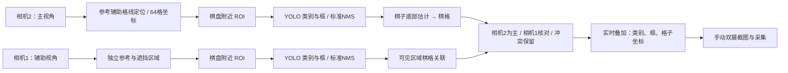

# 实拍棋具适配：YOLO 微调与双摄棋格识别

更新：2026-10-23。当前对象为下图中的实体棋具、带坐标边框的黑白棋盘和固定双摄环境。

**目前已跑通实时“棋子类别＋检测框＋棋格坐标”的预览链路，经过实拍数据微调，当前棋具的棋子检测已取得较高的初步匹配率。** 最新模型在两组留出局面的相机 2 照片上，正确类别且框匹配的比例由 **46/56（82.1%）提升到 53/56（94.6%）**。

这里有两项不同的证据：实时链路已用较早模型完成接入验收；最新 28 组模型已完成离线留出测试，**尚未替换实时服务中的权重**。94.6% 是棋子检测指标，不是棋格坐标准确率、双摄融合准确率或整盘全对率。两组主视角测试图均仍有错误，整盘全对为 **0/2**。

## 1. 当前实验环境


上图由项目使用者提供，保留原图像素。桌面上有 SO-ARM101 主动臂与从动臂、标准黑白棋盘、当前实体棋子；右下方蓝边棋盘是此前试用的棋盘。当前训练的双摄照片来自标准黑白棋盘。

| 部分 | 配置与用途 |
| --- | --- |
| 相机 2 | 固定侧视主相机，主要负责棋子识别与棋格关联；画面需要按安装方向旋转 |
| 相机 1 | 从动臂上的辅助相机，视角不同，夹爪会遮挡部分棋盘 |
| Ubuntu 主机 | 双摄采集、在线预览和现有识别链路 |
| Windows 训练机 | NVIDIA RTX 5070 Laptop GPU，8 GB 显存 |
| 训练软件 | Python 3.10.20，PyTorch 2.7.1+cu128，Ultralytics 8.4.173，OpenCV 4.11.0 |
| 棋盘方向 | 分别配置两台相机的格子编号方向，使用 a–h、1–8 坐标 |

本阶段检查视觉和采集链路，没有执行机械臂抓放。保存初始关节状态与视觉识别是独立功能；识别结果尚未构成可执行的抓取坐标。

## 2. 实时链路是如何工作的



这是一条组合视觉链路：**YOLO 预测棋子的颜色、种类和框；几何模块负责棋盘格线与格子编号**。YOLO 没有在本轮同时学习 64 个格子，也没有新训练棋盘检测器。

1. 每台相机分别保留已核查的参考图、棋盘网格和坐标方向。当前图像通过参考特征跟踪、单应性拟合及黑白交叉检查更新网格；棋盘小幅移动不等于每次从零标定。
2. 取棋盘附近的视图，保持棋子外观，不先把立体棋子透视拉伸成俯视图；YOLO 输出 12 种颜色＋棋子类别。
3. 现有实时服务使用 YOLO 标准 NMS 输出，同格重复框在关联时标成冲突。下文离线对照另外应用“大框优先”规则，筛除高度重叠、底部接近的小框；该规则尚未接入本次引用的实时服务版本，不能把它算作截图中已经完成的处理。
4. 从框估计棋子底部位置，再映射到格子。底部估计仍是启发式方法；边界、遮挡和重复归属会保留为未确定或冲突。
5. 相机 2 为主；相机 1 在可用且未遮挡时提供核对。两相机使用各自的映射，不直接叠加像素坐标。冲突不会被静默覆盖，辅助视角单独发现的棋子保持暂定，未知格不直接认作空格。

现有在线裁切按已定位网格向左右各扩 15%、向上扩 25%、向下扩 10%；网格失效时回退整图。这与下文离线评测的 GT 辅助紧裁切并不完全相同，因此接入新权重时仍须对齐裁切与后处理，再检查实际输入分布和棋格关联。大框优先也不是“面积大就一定正确”。

参考图和坐标方向仍是必要条件。相机大幅转动、棋盘外观变化或超出参考跟踪范围时，需要更新参考；这不是任意环境下完全自动冷启动的棋盘识别。

### 已有实时画面：类别＋坐标


这张图是 2026-10-23 实时服务验收时保存的**真实输出，使用 R1 手机照片模型**，不是最新 R3 的效果图。图中的错误类别与未确定关联均保留，主要用来证明“图像 → 类别 → 网格坐标 → 预览”的链路已经工作。

辅助视角见 [相机 1 的实际输出](docs/assets/real-vision-20261023/live-camera1-grid.jpg)。预览支持独立叠加开关、0/90/180/270°旋转、暂停、双摄截图和本地采集目录。训练同时使用两个视角；“相机 2 为主”是在线关联规则，并不意味着训练时排除相机 1。

实时验收保存的一次状态中，两路网格均有效；网格计算约 13.8/16.0 ms，状态中的处理耗时约 39.3/46.0 ms，双摄时间差约 105 ms。这只是**瞬时状态样本**，不能换算成持续实时 FPS 或最新模型端到端延迟。见 [去除主机地址后的接入验收记录](artifacts/real-vision-20261023/live-acceptance.json)。

## 3. 数据如何采集、标注和准备

先摆放不同局面，每次保存一组双摄照片。GPT 结合两个视角判断棋盘、棋子类别和所在格子，项目使用者检查并纠正，尤其针对黑车、黑象、黑王和黑后。以修正后的类别与可见框导出 YOLO 标签；棋局关联数据保留用于检查，但不作为这轮 YOLO 的额外输出头。

训练图采用正向的棋盘附近裁切，包含棋盘四边形及所有已标注的可见棋子框，增加 8 像素边距并限制在图像内。保留部分遮挡棋子的可见标注，不为完全不可见的棋子虚构框。标签框不少由旧检测框辅助产生，再经过核查；它们不是独立逐像素精标。

最新批次 28 组共 56 张照片、1,381 个视角内棋子框。同一个棋子在双摄中出现，会计为两个视角标签。

| 分区 | 组号 | 组数 | 图片 | 棋子框 |
| --- | --- | ---: | ---: | ---: |
| 训练 | 除下列验证、测试组外的其余组 | 23 | 46 | 1,131 |
| Validation | 15、21、27 | 3 | 6 | 137 |
| Test | 16、25 | 2 | 4 | 113 |

同组双摄始终放在同一分区。测试组来自后续采集批次，未进入初始化权重的训练。本轮优化不混入旧手机照片，但初始化权重自然仍保留历史训练信息。

四张训练图沿用既有的背景遮罩，均不覆盖标注框；验证、测试保留原始 ROI 像素。6 个尚有不确定性的格子类别（12 个双摄标签）仅保留在训练：17c1、18e1、19c2、20c2、20e2、28d4。它们没有被称作独立确认的真值，也不进入验证或测试。完整分区和哈希见 [数据清单](artifacts/real-vision-20261023/groups28-split.json)。

## 4. 一共训练了几次

当前实拍适配路线完成 **3 次独立微调作业**，每次从上一份权重初始化新的优化器，不是恢复上一轮优化器状态：

```text
ChessReD2K 原始 YOLOv8m
  └─ R1：手机照片微调（2026-10-22）
       └─ R2：首批双摄修正标签微调（2026-10-23）
            └─ R3：28组双摄数据微调（2026-10-23，最新候选）
```

| 作业 | 实际训练数据 | 验证 / 测试 | 完成轮数 | 最佳轮数 | 作业耗时 |
| --- | --- | --- | ---: | ---: | ---: |
| R1 手机照片 | 去重后 24 张中的 13 张训练，341 框 | 5 张 / 6 张 | 57 | 37 | 143.1 s |
| R2 首批双摄 | 第 1、3、4、5、7 组双摄 10 张＋旧手机训练图 13 张，共 23 张、583 框 | 8/9/10 组；12/13 组 | 45 | 25 | 111.4 s |
| R3 28组 | 23 组双摄、46 张、1,131 框；无旧手机回放 | 15/21/27 组；16/25 组 | 66 | 46 | 267.0 s |

R2 当时因标签不确定排除了第 2、6、11 组，所以主相机只有 5 张新图进入训练。R3 已纳入这 28 组的全部数据，再按 23/3/2 分区，主相机有 **23 张训练图**。

另有 2026-10-07 的 **1 次 Dubrovnik 合成数据微调**（15 轮，约 23.1 分钟），属于不同棋具和数据域，**不是上述实拍权重链的初始化分支**。它在 456 张合成测试图上的占用格颜色＋种类正确率为 60.32%→99.85%，整盘全对 0/456→442/456；不能用来代替实拍精度。详见 [原实验](EXPERIMENT.md) 和 [原始训练曲线](artifacts/dubrovnik-v1/training_curve.png)。按此范围，本项目报告涵盖 1 次合成训练和 3 次实拍微调。

### 实拍微调设置

三次都使用 YOLOv8m，保留原有 13 类输出头：12 个有效棋子类别及上游 `empty` 类；没有 `empty` 框训练目标。格子是否为空由后续状态逻辑处理。

| 参数 | R1 | R2 / R3 |
| --- | --- | --- |
| 输入尺寸 / batch | 960 / 2 | 960 / 2 |
| 优化器 / 初始学习率 | AdamW / 0.0003 | AdamW / 0.00015 |
| 冻结 | 前 10 层 | 前 10 层 |
| 最大轮数 / 早停 patience | 80 / 20 | 80 / 20 |
| 学习率 | cosine，末端比例 0.1 | 同左 |
| weight decay / warmup | 0.0005 / 3 轮 | 同左 |
| AMP / workers | false / 0 | false / 0 |
| seed | 20261022 | 20261023 |

采用轻量 HSV、平移 0.06、缩放 0.15、旋转 5°、水平翻转 0.5；关闭 mosaic、mixup 和透视增强。水平翻转只影响检测训练，不改变运行时固定的棋格坐标方向。以验证集 **mAP50–95** 选最佳 checkpoint；R3 的验证指标合并两路相机，并非仅按相机 2 选择。没有使用测试结果调超参数，也没有追加随机种子搜索。

## 5. Loss 下降过程


每行对应一次真实训练；前三列依次是框定位 loss、分类 loss 和 DFL，最后一列是验证集 AP。实线直接来自逐轮 CSV，**未平滑、未挑选局部轮次**；虚线标记最终选用的最佳轮数。不同训练数据下的 loss 绝对值不直接横向比较。

最新 R3 的具体变化：

| 指标 | 第 1 轮 | 最佳第 46 轮 | 最后第 66 轮 |
| --- | ---: | ---: | ---: |
| train box loss | 0.72972 | 0.53047 | 0.47535 |
| train cls loss | 0.83559 | 0.31768 | 0.28586 |
| train DFL loss | 1.25478 | 1.05144 | 1.01012 |
| val cls loss | 2.15096 | 0.42364 | 0.45814 |
| val mAP50–95 | 51.31% | **76.82%** | 75.01% |

训练 loss 在后期仍下降，但验证表现没有持续改善，因此使用第 46 轮权重而不是第 66 轮。**训练 loss 降低本身不能证明新场景识别可靠。**

逐轮原始记录：[R1 CSV](artifacts/real-vision-20261023/r1-phone-training.csv)、[R2 CSV](artifacts/real-vision-20261023/r2-dual-pilot-training.csv)、[R3 CSV](artifacts/real-vision-20261023/r3-groups28-training.csv)。

## 6. 几次训练后，识别表现怎样变化

### 各轮自己的留出测试集：检测 AP


| 作业与测试集 | 测试 mAP50：前 → 后 | 测试 mAP50–95：前 → 后 |
| --- | ---: | ---: |
| R1：6 张手机照片、132 标签 | 46.29% → **94.99%** | 33.79% → **70.19%** |
| R2：12/13 组双摄、118 视角标签 | 54.11% → **72.60%** | 51.68% → **64.89%** |
| R3：16/25 组双摄、113 视角标签 | 67.96% → **89.47%** | 55.99% → **71.34%** |

**只比较每一行的前后。** 测试集、棋盘、视角和遮挡不同，不能把 94.99%→72.60%→89.47% 当作同一测试集上的模型升降。AP 是检测评估指标，不等同于逐棋子的正确比例。以上官方测试不应用大框优先后处理。

### 固定阈值下的类别与框匹配

采用 conf=0.25、NMS IoU=0.7，按类别无关的降序 IoU 贪心一对一匹配，IoU≥0.5 且类别一致才算正确。分母包含漏检和错类的 GT 棋子。重复预测另行统计；这些比例不是“precision”，也不包含自动格子映射是否正确。

| 测试范围 | 处理方式 | 微调前 | 微调后 |
| --- | --- | ---: | ---: |
| R1 手机照片 | 棋盘 ROI，原始框 | 43/132（32.6%） | 118/132（89.4%） |
| R2 相机 2 | 棋盘 ROI＋大框优先 | 46/59（78.0%） | 49/59（83.1%） |
| R2 相机 1 | 同上 | 21/59（35.6%） | 39/59（66.1%） |
| **R3 相机 2** | **棋盘 ROI＋大框优先** | **46/56（82.1%）** | **53/56（94.6%）** |
| R3 相机 1 | 同上 | 34/57（59.6%） | 48/57（84.2%） |

R1 的整张手机图只从 83/132 提升到 89/132，明显弱于 ROI 输入，说明裁切输入与实际使用方式需要一致。这里的 ROI 由已核查的标注范围得到，**不是对自动棋盘定位成功率的评测**。

R3 主相机原始框正确 51/56，大框优先后为 53/56；额外未匹配预测从 6 个降到 1 个。相同规则在 R2 辅助视角曾删除正确候选（42→39），所以不把该后处理当作普遍保证。

### 最新模型的主视角实际例子

| 第 16 组：微调前 19/26 | 第 16 组：微调后 24/26 |
| --- | --- |
|  |  |

| 第 25 组：微调前 27/30 | 第 25 组：微调后 29/30 |
| --- | --- |
|  |  |


改善例子包括第 16 组 b5 黑车、第 16 组 d5 黑象、第 25 组 e2 黑王。仍存在：

- 第 16 组 f3：黑车识别为黑后。
- 第 25 组 f2：黑车识别为黑王。
- 第 16 组 g4：受遮挡白后没有 IoU≥0.5 的匹配框。
- 第 16 组另有 1 个额外未匹配预测，已独立计数。

上述格名来自已核查的 GT 对应关系，用于说明错误位置；并非本次模型预测坐标准确率的统计。最新测试中，黑车仍只有 3/5 正确，黑王为 1/1、黑后为 2/2，后两者样本过少，不能据此断言混淆已经解决。

## 7. 当前结论与下一步

在当前棋具与采集条件下，**实拍数据＋人工纠正 GPT 标注＋棋盘附近输入**已显著改善棋子检测；实时显示类别、框和格子坐标的工程链路也已经跑通。下一步是把 R3 作为候选接入相同实时链路，测新局面和跨天数据，分别检查类别、棋格归属、完整棋局以及持续延迟，再决定是否作为默认模型。

当前边界包括：

- R3 只有两组留出局面；采集会话、棋具和机位相同，相邻摆放可能相关，尚无跨天泛化或多随机种子证据。
- R1 的 6 张留出照片来自两种相关摆放，且早期图片检查曾影响初始权重选择；它不是完全盲测。R1 的高 AP 不能外推到标准棋盘双摄环境。
- 训练标注存在前述 6 个暂定格子；遮挡框与底部归属也有近似误差。
- 最新离线测试不包含自动棋盘定位、网格关联和融合后的完整棋局评分；实时端类别正确率另需测量。
- 辅助视角使用固定保守遮挡区域，不具备通用动态手部遮挡分割；少看见棋子不能直接解释成空格。
- 本次发布复用已有训练、预测和实时验收记录，没有新增训练、在线部署或机械臂动作。

数据分析与原始记录核查由同一 GPT 分别进行，`independent=false`，不是第二位独立审核者。既有代码实现沿用项目 DeepSeek 流程，本次整理没有新增实现 API 调用。

## 8. 发布内容与追溯

本分支发布说明、原始 loss CSV、汇总指标、分区哈希、模型指纹、实际预测图片与环境照片。完整私有采集目录、主机连接信息、凭据和本轮 checkpoint 文件未打包；仓库原有的 `models/dubrovnik-yolov8m-v1.pt` 仍是旧合成模型，**不能当作 R3 实拍模型**。

最新候选 `best.pt` SHA-256：

```text
72997374c6f835409880c1973bab732460e726a6eac631c50953fbbf917a6819
```

- [训练沿革、配置、checkpoint 哈希](artifacts/real-vision-20261023/training-history.json)
- [R3 数据分区及图像/标签哈希](artifacts/real-vision-20261023/groups28-split.json)
- [R3 原始评估汇总与残余错误](artifacts/real-vision-20261023/groups28-evaluation.json)
- [R3 模型信息](artifacts/real-vision-20261023/checkpoint.json)
- [实时接入验收](artifacts/real-vision-20261023/live-acceptance.json)与[参考网格核查](artifacts/real-vision-20261023/grid-registration-audit.json)
- [图片/CSV 来源与哈希](artifacts/real-vision-20261023/asset-provenance.json)

所有结果均来自已完成的原始作业；曲线为读取历史 CSV 后重新绘制，没有为发布而重训模型。
